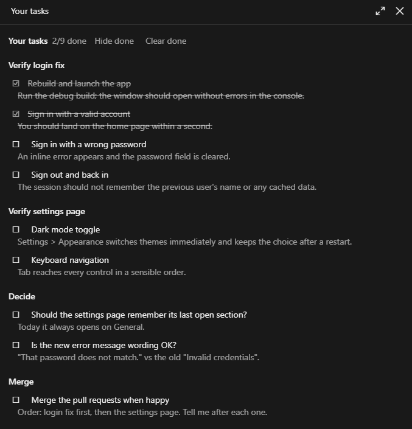

# ivo-skills

Personal skills for **Claude Code** and **Codex**, in one repo.

Both hosts read the same `SKILL.md` files. Only the manifests differ, so each skill
is written once and stays in sync everywhere.

Both hosts namespace a plugin's skills by the plugin name, so these are referenced
as `ivo:<skill>` — the `ivo-` prefix lives in the namespace, not in the skill names.

## Skills

| Skill | What it does |
|---|---|
| `ivo:code` | Implementation and review using the smallest complete solution that stays clear, correct, and maintainable |
| `ivo:deslop` | Evidence-based slop audits and scoped cleanup that preserve supported behavior |
| `ivo:teach` | Socratic mode — guides toward the answer instead of handing it over |
| `ivo:exam` | PR understanding exam with code questions; every question must pass before understanding is marked ready |
| `ivo:simple` | Rewrites one answer in extremely plain English, no jargon |
| `ivo:context-check` | Reports every instruction and file auto-loaded into the session |
| `ivo:roast-codebase` | Code review that is funny and actually useful |
| `ivo:remove-bg-image` | Flood-fill background removal to a transparent PNG |
| `ivo:codex` | From Claude Code: start or resume a Codex session with a focused note (login check first) |
| `ivo:claude` | From Codex: start or resume a Claude Code session with a focused note (**untested**) |

`ivo:code` guides everyday coding; `ivo:deslop` provides a deliberate cleanup pass.
For example, ask `Use $ivo:deslop to audit my current changes` for findings without
edits, or `Use $ivo:deslop to clean up src/widgets` for scoped changes. It can also
audit a whole repository and prioritize areas to tackle. Significant design
tradeoffs stay with Ivo; supported local cleanup does not need repeated approval.

## Install

### Claude Code

```
/plugin marketplace add vakisddot/ivo-skills
/plugin install ivo@ivo-skills
```

### Codex

```
codex plugin marketplace add vakisddot/ivo-skills
codex plugin add ivo@ivo-skills
```

Start a new thread/session afterwards so the host picks up the skills.

For local development, point either host at the working copy instead:

```
codex plugin marketplace add /path/to/ivo-skills
claude plugin marketplace add /path/to/ivo-skills
```

## Mods

`app-runner` is a separate, Claude Code-only plugin: a mod, not a skill, so Codex
does not load it. It adds a Start/Stop band above the prompt, plus
`/ivo-runner-start [profile]`, `/ivo-runner-stop` and `/ivo-runner-toggle` (show or
hide the band; the band's Hide button does the same), for any checkout that has a
`.claude/run.json`:

```json
{
  "profiles": [
    {
      "name": "Game",
      "build": ["dotnet", "build", "Game/Game.csproj"],
      "run": ["Game/bin/Debug/net8.0/Game.exe"],
      "cwd": "Game/bin/Debug/net8.0"
    }
  ]
}
```

Paths are relative to the session's checkout, so a worktree session runs its own
branch. The first profile is the default. `build` is optional. The app is launched
through PowerShell `Start-Process` so its window shows; `/ivo-runner-stop` runs `taskkill` on
its PID. Windows only. The app outlives the session and a mod reload; stop it first.

```
/plugin install app-runner@ivo-skills
```

Check it after editing:

```
claude plugin validate plugins/app-runner
claude plugin test plugins/app-runner
```

`user-tasks` is a second mod: a "Your tasks" checklist pane that stays beside the chat.
Things Claude asks you to check or do (a test checklist, say) go there instead of
scrolling away in the transcript; you tick them off and Claude can read what you ticked.
Lists are per project (a worktree shares its repository's list) and survive restarts.
Claude writes to it through one tool, `mcp__user-tasks__user_tasks` (`add`, `update`,
`remove`, `clear`, `list`), documented in `plugins/user-tasks/skills/user-tasks`.
`/ivo-tasks` reopens the pane if you closed it. Ticked items are struck through;
Hide done and Clear done tidy the list. Clicking a task's `#N` puts `Regarding user task #N, ` in
your prompt, so Claude knows which one you mean.
A task's title or detail can also hold a link Claude adds back to the chat, which scrolls
the transcript to the passage that explains it.



```
/plugin install user-tasks@ivo-skills
```

## Layout

```
.claude-plugin/marketplace.json     Claude Code entry point   (marketplace: ivo-skills)
.agents/plugins/marketplace.json    Codex entry point         (marketplace: ivo-skills)
plugins/ivo/
  .claude-plugin/plugin.json        Claude manifest
  .codex-plugin/plugin.json         Codex manifest (semver + interface metadata)
  skills/<name>/
    SKILL.md                        read by both hosts
    agents/openai.yaml              Codex display metadata; ignored by Claude
```

Both marketplaces resolve plugin sources as `./plugins/<name>` relative to the repo
root, so a single `plugins/` tree serves both.

## Updating a skill

Both hosts snapshot the plugin into a version-keyed cache at install time, so editing
a `SKILL.md` in this repo does **not** reach a running host on its own. Re-sync after
editing:

```
codex plugin add ivo@ivo-skills

claude plugin uninstall ivo@ivo-skills
claude plugin install ivo@ivo-skills
```

Codex re-copies on a plain re-add even at the same version. Claude's
`plugin update` is version-gated and reports "already at the latest version" for
same-version edits, so uninstall/reinstall (or bump `version`) is required there.
Start a new session afterwards.

After editing manifests, revalidate both sides:

```
claude plugin validate plugins/ivo
python3 ~/.codex/skills/.system/plugin-creator/scripts/validate_plugin.py plugins/ivo
```

## Host neutrality

One copy of each skill serves both hosts, so skill text must not name a specific
assistant. Refer to instruction files as "CLAUDE.md, AGENTS.md, or equivalent", and
write "your last response" rather than naming the assistant. The exception is
`ivo:codex` and `ivo:claude`, which name the assistant they talk to and say which
host to use them from.
